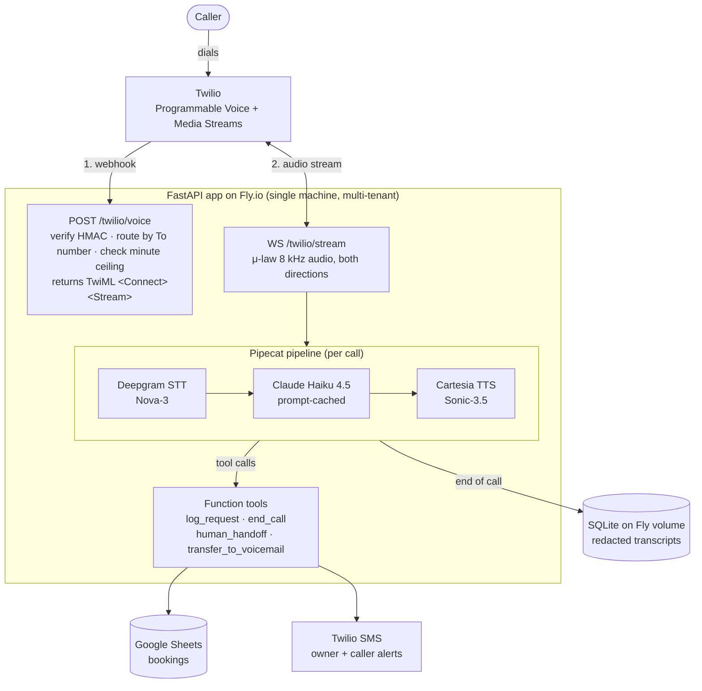

# AI Voice Receptionist

An AWS implementation is available in [infra/aws/README.md](infra/aws/README.md).
It keeps the Fly.io deployment intact and adds an ECS/Fargate, Bedrock, S3,
DynamoDB, IAM, Secrets Manager, CloudWatch, and event-driven post-call agent
variant. The AWS variant has not been deployed to an AWS account.


A production-grade AI phone receptionist for small service businesses. Inbound calls go Twilio → Fly.io → [Pipecat](https://github.com/pipecat-ai/pipecat) (Deepgram STT + Claude Haiku + Cartesia TTS) with real-time streaming at under 1 s end-to-end latency. Bookings land in Google Sheets via a function tool; SMS notifications fire on high-urgency calls.

## What it does

- Answers the phone, qualifies the caller, collects booking intent
- Books jobs into Google Sheets via function calling
- Sends SMS alerts to the owner for urgent calls (after-hours, emergencies)
- Falls back to voicemail capture when needed
- Serves multiple clients from one deployment (per-client config + prefixed secrets)
- Caches greeting TTS to cut first-word latency
- Redacts PII (Presidio + spaCy) before persisting transcripts; honors GDPR/PIPA retention modes per client

## Architecture

A single FastAPI process on Fly.io serves every client. Each inbound call is routed to the right tenant by its destination Twilio number, then handed to a per-call Pipecat pipeline that streams audio in both directions.



**How a call flows:**

1. **Webhook.** Twilio POSTs `/twilio/voice`. The app validates the HMAC-SHA1 signature, looks up the `ClientContext` by the inbound `To` number, checks the per-client minute ceiling, and returns TwiML that opens a Media Stream.
2. **Audio.** Twilio opens the `/twilio/stream` WebSocket. A signed routing parameter resolves the client no matter which machine handles it, then a Pipecat pipeline runs for the length of the call: μ-law audio → Deepgram STT → Claude Haiku → Cartesia TTS → back to Twilio.
3. **Tools.** Once the model has enough intent, it calls `log_request`, which appends a row to Google Sheets and fires SMS (a caller confirmation, plus an owner alert on emergencies). It can also invoke `transfer_to_voicemail`, `human_handoff`, and `end_call`.
4. **End of call.** Minute accounting is reconciled, and the transcript is PII-redacted and written to SQLite on the Fly volume. That write is best-effort and never blocks the call path.

A second, stateless **demo surface** (`POST /auth/demo` + `POST /text-chat`) reuses the same model and system prompt over text for sales demos, with no telephony or tool registration.

See [`.planning/codebase/ARCHITECTURE.md`](.planning/codebase/ARCHITECTURE.md) for the full component map, data-flow detail, and the per-stage ASCII pipeline diagram.

## Stack

| Layer | Technology |
|---|---|
| Telephony | Twilio Media Streams (WebSocket, μ-law 8 kHz) |
| Voice framework | [Pipecat](https://github.com/pipecat-ai/pipecat) 1.2.1 |
| STT | Deepgram Nova-3 (streaming) |
| LLM | Claude Haiku 4.5 (Anthropic, prompt-cached) |
| TTS | Cartesia Sonic-3.5 (streaming) |
| Backend | FastAPI on Fly.io (single `shared-cpu-1x` machine) |
| Bookings | Google Sheets via Service Account |
| Notifications | Twilio SMS |
| Transcript store | SQLite (WAL) on a Fly volume |
| PII redaction | Microsoft Presidio + spaCy NER |

## Project layout

```
tools/llm_proxy/     # Core app: voice pipeline, routes, function tools
tools/prompts/       # Prompt templates (v0.3 data-driven receptionist)
config/clients/      # Per-client JSON configs (twilio_number, hours, prompt)
infra/fly/           # Dockerfile, entrypoint, fly.toml
tests/               # pytest suite (264 tests)
docs/                # Architecture audit, GDPR gap analysis
.planning/           # Specs, plans, and phase tracking
```

## Quick start

**Prerequisites:** Python 3.12, a Fly.io account, a Twilio number, API keys for Anthropic / Deepgram / Cartesia, and a Google Service Account with Sheets access.

```bash
cp .env.example .env
# fill in all keys
pip install -r requirements.txt
uvicorn tools.llm_proxy.main:app --reload
```

See `DEMO_STARTUP.txt` for the full deploy walkthrough and `RUNBOOK.md` for operations.

## Multi-tenant

Each client gets a JSON file in `config/clients/` and prefixed Fly secrets (`{PREFIX}_GOOGLE_SHEET_ID`, etc.). One Fly app serves all clients; Twilio routes to the right client by inbound number. See `RUNBOOK.md → Onboard a 3rd client`.

## Testing

```bash
.venv/bin/python -m pytest tests/ -v
```

264 tests cover routing, function tools, PII redaction, client config, caching, container hardening, and the digest pipeline. CI (`.github/workflows/ci.yml`) runs `ruff` + `pytest` on every push and PR.

## Deployment

```bash
flyctl deploy -c infra/fly/fly.toml --app <your-app-name>
```

Secrets live in Fly (`fly secrets list`), never in `.env` in production. See `SECRETS.md` for the full inventory and rotation procedures.

## Design decisions

The choices below are the ones that most shaped the system. Full rationale (and the architectural debt each one carries) lives in [`ARCHITECTURE.md`](.planning/codebase/ARCHITECTURE.md).

- **WebSocket Media Streams, not REST, for audio.** Real-time voice can't tolerate polling latency. Twilio Media Streams pushes bidirectional μ-law 8 kHz frames over a persistent WebSocket, and the app streams TTS back incrementally as it's produced.
- **Pipecat as the pipeline framework.** Frame-based audio buffering, VAD (Silero), turn detection, and the service adapters (Deepgram, Anthropic, Cartesia) come for free instead of hand-rolled glue. The catch is a heavy cold start, roughly 5 to 10 seconds for the VAD and ONNX models, so we warm them at startup.
- **Claude Haiku 4.5 locked on the call path.** Sonnet or Opus would cost three to five times more per call at the same volume, with no receptionist-quality gain. The model id is a single constant shared by the voice, demo, and digest paths.
- **Routing by the inbound `To` number, not URL prefixes or subdomains.** `app.state.clients` is a `dict[twilio_number, ClientContext]`. Onboarding a client means provisioning a Twilio number and adding a JSON file, with no code change.
- **Signed Media-Stream routing parameter.** The destination number rides on the Stream URL, HMAC-signed with the client's auth token, so the WebSocket resolves its tenant no matter which machine handles it. It also stops a caller from forging a `To` to start a paid session.
- **Minute ceiling enforced in application code.** Deepgram, Cartesia, and Fly have no hard billing caps, so the admission check at `/twilio/voice` (which counts in-flight reservations, not just completed calls) is the only hard stop on spend.
- **Prompt caching with a byte-stable prefix.** The system prompt is identical across calls, so Anthropic's cache gets read rather than rewritten on every call. The volatile time context rides as a separate, hour-granular message, so calls in the same hour share a cache prefix.
- **Single-machine, in-memory state by design.** The client registry, pending-call bridge, minute counters, and demo tokens are all in-process dicts, and transcripts live in SQLite on a single-attach Fly volume. That's deliberate at the current scale, and the Postgres/Redis migration path is written down for when a second machine ships.
- **Per-client GDPR and PIPA compliance modes.** A client's `gdpr_mode` or `pipa_mode` flag swaps the system-prompt prefix and the retention default, and in PIPA mode it forces a deterministic disclosure greeting before the LLM's first turn.

## Lessons learned

A few things this project taught us the hard way. Most surfaced from a 43-agent adversarial audit (28 verified findings, all fixed for $0 since they were code and config only) and from live-call diagnostics.

- **Config that "looks right" can be silently ignored.** In Pipecat 1.2.1 the VAD analyzer has to be passed via `LLMUserAggregatorParams`. The code passed it to the transport params instead, where it was quietly dropped, so VAD and interruptions never actually engaged. Nothing errored. The takeaway: verify behavior with a live call, and don't assume a plausible-looking parameter took effect.
- **Single-machine assumptions leak during the deploy window.** Calls dropped (the "three beeps", Twilio error 31921) on *every* rolling deploy. For the few seconds two machines coexist, the in-process HTTP-to-WebSocket bridge couldn't find the client. The fix was to sign the destination number onto the Stream so resolution no longer depends on the machine. A "single machine" system is briefly a two-machine system on every deploy.
- **Blocking work in an async hang-up path freezes *other* calls.** End-of-call PII redaction and SQLite writes ran synchronously in the async teardown, stalling every concurrent call and new-call setup. Moving them to a worker thread fixed it. Worth auditing the async path for hidden synchronous CPU or IO.
- **Caller-controlled text is untrusted input, even when it's only headed for a spreadsheet.** Names, addresses, and voicemail transcripts written with Sheets' `USER_ENTERED` mode let a caller inject `=IMPORTRANGE` or `HYPERLINK` formulas to exfiltrate data. Switching to `RAW` stores them literally.
- **The container is a different environment than the tests.** Two failures only a real deploy would catch: the first deploy 503'd because the Dockerfile `COPY` left out the `config/` directory, and the redactor expects spaCy's `en_core_web_lg` while the image installed `en_core_web_sm`. Static tests pass, so staging-deploy before prod anyway.
- **"It looks off" isn't a diagnosis.** Prompt caching *appeared* disabled but had been on the whole time. The 5-minute cache TTL plus our sparse call volume just meant most calls missed the window. Separately, a voice-distortion "CPU burst" theory was ruled out only by sampling actual CPU during calls. Gather the data first, then form the hypothesis.
- **Don't optimize what's already optimal.** A latency-reduction pass found that Pipecat's 1.2.1 defaults already handled smart-turn detection, VAD, and the right model tiers, and the TTS model we were using (Sonic-3.5) was already the fastest current-generation option. The win was leaving things alone and writing down why.
- **Cost is a first-class constraint.** The whole hardening pass shipped for $0 by staying in code and config. Bigger Fly machines or model upgrades are a last resort, and when we reach for one we quote the cost delta and a cheaper alternative first.

## License

MIT
