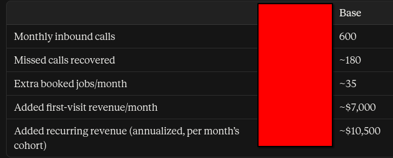
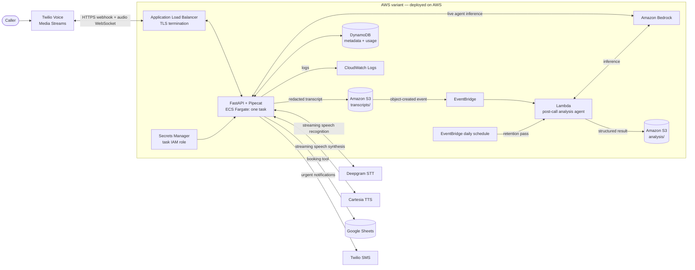

# AI Voice Assistant — AWS Variant

This repository contains an AWS-oriented version of a multi-tenant AI phone
receptionist. It adds Amazon Bedrock inference, an ECS Fargate deployment
configuration, AWS storage and secrets integration, and an event-driven
post-call analysis agent to the [original Fly.io project](https://github.com/nub088/ai-voice-assistant).

**Deployment status:** The original voice assistant ran on Fly.io. This AWS
variant and its CloudFormation infrastructure **have been deployed on AWS**
but have not been load tested. The diagrams and deployment instructions
below describe the deployed configuration.

## What the assistant does

- Answers inbound Twilio calls and routes them by destination number to a
  tenant-specific voice agent.
- Streams bidirectional phone audio over Twilio Media Streams and WebSocket.
  Pipecat coordinates Deepgram speech recognition, LLM reasoning, and Cartesia
  speech synthesis.
- Uses function tools to log booking requests in Google Sheets, send urgent
  Twilio SMS notifications, end calls, and handle handoff or voicemail flows.
- Applies tenant-specific prompts, usage ceilings, PII redaction, transcript
  retention rules, and conversational regression scenarios.
- On AWS, can call an existing Bedrock Knowledge Base through the optional
  `retrieve_knowledge` tool when its ID is configured.

## Example business impact

Base scenario for a business handling 600 inbound calls per month:



## AWS architecture

A single FastAPI/Pipecat task runs on ECS Fargate behind an HTTPS Application
Load Balancer. The live voice agent uses a Bedrock model selected at deployment.
After a call, the application redacts its transcript before writing it to S3.
An S3 object-created event goes through EventBridge to a Lambda post-call agent,
which uses Bedrock for structured follow-up analysis. A daily EventBridge rule
invokes the same Lambda for retention work.



The deployment template also defines the VPC, public subnets, task and load
balancer security groups, ECR repository, IAM roles, and optional Route 53
record. The task obtains configuration from an existing Secrets Manager JSON
secret. S3 lifecycle rules expire transcript and analysis objects after 90
days as a backstop to the scheduled retention process. See the
[AWS deployment guide](infra/aws/README.md) for configuration and caveats.

### Call and data flow

1. Twilio sends the inbound webhook to `/twilio/voice` through the load
   balancer. The app verifies the Twilio signature, resolves the tenant by the
   called number, checks its minute ceiling, and returns TwiML for a Media
   Stream.
2. Twilio opens `/twilio/stream` over WebSocket. Pipecat streams audio through
   Deepgram, the Bedrock LLM adapter, and Cartesia. The agent can call booking,
   notification, handoff, voicemail, and optional retrieval tools.
3. At call end, the app reconciles usage and redacts the transcript before
   persisting it in S3; metadata and minute counters go to DynamoDB.
4. S3 emits an object-created event. EventBridge invokes the post-call Lambda,
   which reads the redacted transcript, asks Bedrock for structured analysis,
   and writes the result under `analysis/` in S3.

This is a speech-to-text → LLM → text-to-speech pipeline. Twilio handles the
phone network; this application does not terminate SIP or RTP, use WebRTC or
Amazon Connect, or implement direct speech-to-speech inference. The optional
retrieval tool uses an **existing** Bedrock Knowledge Base; this stack does not
create or populate one.

## Components

| Concern | AWS variant |
| --- | --- |
| Phone and audio transport | Twilio Programmable Voice, Media Streams, WebSocket |
| Voice orchestration | Pipecat in FastAPI on one ECS Fargate task |
| Speech recognition and synthesis | Deepgram STT and Cartesia TTS |
| Live LLM and optional retrieval | Amazon Bedrock; existing Knowledge Base if configured |
| Booking and alerts | Google Sheets and Twilio SMS |
| Transcript and analysis objects | Amazon S3 |
| Call metadata and usage | Amazon DynamoDB |
| Post-call analysis and retention | EventBridge and AWS Lambda |
| Secrets, access, and logs | Secrets Manager, IAM, and CloudWatch Logs |
| Infrastructure definition | CloudFormation; container image in ECR |

## Repository layout

```text
tools/llm_proxy/       FastAPI routes, voice pipeline, tools, AWS backend
infra/aws/             CloudFormation, Dockerfile, deploy script, Lambda agent
infra/fly/             Original Fly.io deployment configuration
tools/prompts/         Tenant and voice prompt templates
tests/                 Application and AWS variant tests
```

The original Fly.io path remains in this repository. It uses direct Anthropic
inference, Fly secrets, and SQLite on a Fly volume. The AWS variant selects
Bedrock and AWS persistence through its configuration. Historical Fly-specific
design notes are in the [original architecture document](.planning/codebase/ARCHITECTURE.md);
they do not describe a deployed AWS system.

## Local development and verification

Use Python 3.12. The AWS dependency set is in `requirements-aws.txt`; the
original Fly dependency set is in `requirements.txt`. Running locally also
requires the relevant provider credentials and tenant configuration. The AWS
stack requires an AWS account, an available Bedrock model, a domain and ACM
certificate, and the external Twilio, Deepgram, Cartesia, and Google services.

```bash
python -m venv .venv
. .venv/bin/activate
pip install -r requirements-aws.txt
python -m pytest tests/ -q
ruff check tools/ tests/
```

The [AWS deployment guide](infra/aws/README.md) documents the secret shape,
required resources, `deploy.sh` arguments, Twilio webhook setup, and smoke
checks. Its deployment command creates billable AWS resources. Do not treat a
passing local test suite as a deployment or load test.

## Current AWS limitations

- The CloudFormation service runs one Fargate task. Active calls can be
  interrupted by task failure or replacement. In-flight admission state is
  in memory; DynamoDB minute totals do not make multi-task admission atomic.
- DynamoDB retention and deletion paths scan the table and are intended for
  small demo volumes. The original SQLite-based cost script does not yet read
  AWS usage data.
- The Fly-only Twilio recording retention job needs an AWS schedule before
  using voicemail recordings in production.
- Model invocation IAM permissions need narrowing after the model or
  inference profile is chosen. Live-call tests are needed before making
  availability, latency, security, or cost claims.

## License

MIT
